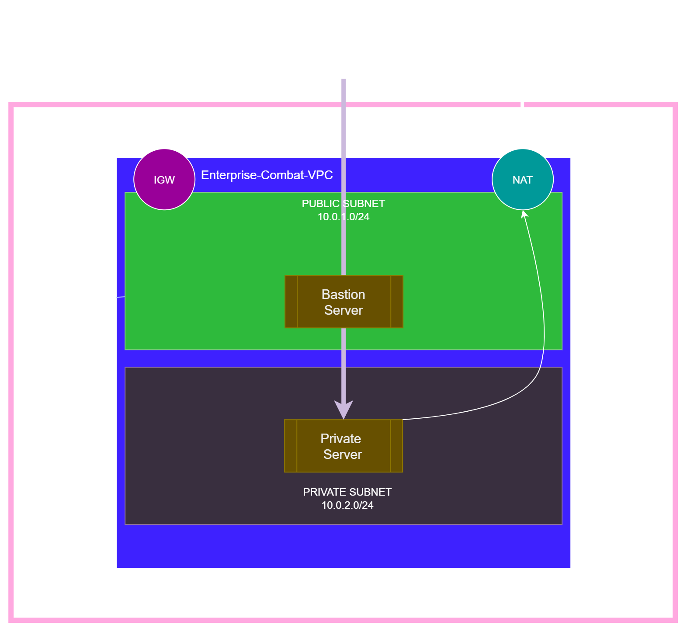
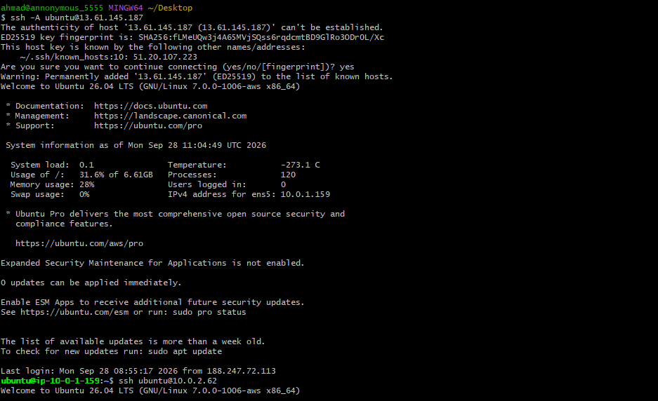
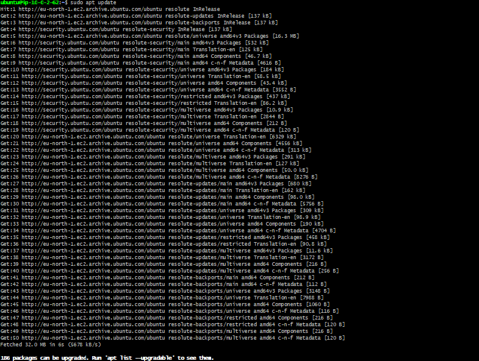

# AWS Enterprise Hybrid VPC Architecture

## Project Overview
This project demonstrates the design and manual implementation of a highly secure, production-ready **Two-Tier AWS VPC Infrastructure** in the `eu-north-1` (Stockholm) region. The architecture is engineered to isolate critical workloads (such as databases) in a strictly private environment while maintaining controlled administrative access and conditional outbound internet connectivity, mirroring real-world banking and FinTech cloud deployments.

## Architecture Diagram

## Core Infrastructure Components

### 1. Network Segmentation (VPC & Subnets)
- **VPC Custom CIDR:** `10.0.0.0/16` providing a scalable address space.
- **Public Subnet (`10.0.1.0/24`):** Hosted in `eu-north-1a`. It has a direct route to the Internet via an **Internet Gateway (IGW)** and hosts the Bastion/Jump Host.
- **Private Subnet (`10.0.2.0/24`):** Hosted in the same Availability Zone for sub-millisecond latency. It isolates the backend/database server from external traffic.

### 2. Advanced Security & Access Control
- **Perimeter Security:** Implemented Custom Security Groups acting as stateful firewalls. 
- **The Golden SSH Rule:** The Private Server's Security Group completely blocks the entire internet, explicitly allowing incoming SSH traffic (Port 22) **only** if the request originates from the Bastion Host's Security Group ID.
- **Bastion Host Access:** The Bastion Host is hardened, allowing SSH access solely from my trusted local IP.

### 3. Secure Administrative Commute (SSH Agent Forwarding)
To avoid the critical security anti-pattern of storing private keys (`.pem`) on the public Bastion server, **SSH Agent Forwarding (`ssh-agent`)** was implemented:
- The private key remains secure on the local machine.
- A cryptographic challenge-response mechanism safely relays authentication through an encrypted tunnel (`ssh -A`), enabling a secure jump from the local machine ➔ Bastion Host ➔ Private Server.

### 4. Conditional Outbound Connectivity (NAT Gateway)
- Implemented a **Zonal NAT Gateway** inside the Public Subnet, assigned with an **Elastic IP (EIP)**.
- Updated the Private Route Table to route destination `0.0.0.0/0` traffic through the NAT Gateway.
- This allows the isolated Private Server to initiate **one-way outbound connections** to fetch secure package updates (`sudo apt update`), while maintaining absolute immunity against unsolicited inbound connections.

## Verification & Proof of Concept

### 📌 SSH Agent Forwarding & Multi-Hop Jump Success
As verified below, the initial secure jump establishes a connection to the Bastion host, followed by an immediate internal multi-hop jump into the private node (`10.0.2.62`) without compromising the private key.

### 📌 Outbound internet Translation via NAT Gateway
The screenshot below confirms that the private server—despite having no Public IP—successfully resolves DNS and pulls official Ubuntu repository updates via the configured NAT perimeter.

## Financial & Lifecycle Clean-Up
To adhere to Cloud Cost Optimization practices, the NAT Gateway was successfully destroyed, the Elastic IP was released back to AWS, and the EC2 nodes were transitioned to a `Stopped` lifecycle state to prevent unnecessary resource bleeding.

---
*Built with absolute theoretical grounding and hands-on validation.*
